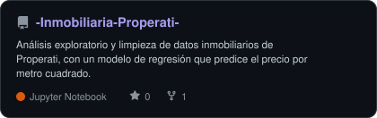
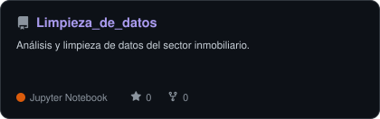
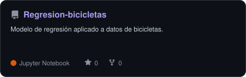
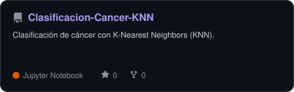
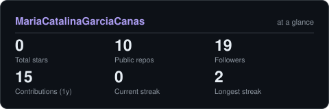

<!-- BANNER - terminal profile.sh --live. Generated by scripts/banner/generate.py.
     ~1 MB each. Cache-bust with ?v=N (or rename v9 -> v10) after regenerating. -->
<picture>
  <source media="(prefers-color-scheme: dark)"  srcset="assets/banner-dark.v9.svg">
  <source media="(prefers-color-scheme: light)" srcset="assets/banner-light.v9.svg">
  
</picture>

 

<!-- NAME / TAGLINE - animated typing -->

 

&nbsp;&nbsp;
&nbsp;&nbsp;
&nbsp;&nbsp;
&nbsp;&nbsp;

 

---

## 👋 Hi there, I'm Cata

**Analytics Engineer & Data Consultant** with an engineering background, broadcasting from Bucaramanga, Colombia 🇨🇴.
I spent years in the field doing non-destructive testing and risk-based inspection in oil & gas, and now I bridge
physical systems with modern cloud data stacks.

- ⚙️ **Data modeling, SQL/query optimization and scalable pipelines** across Snowflake, Microsoft Fabric and Power BI.
- 🔍 Currently exploring the intersection of **Data Engineering and Applied Machine Learning**.
- 📚 Focused on clean architectures, traceable SQL transformations and end-to-end analytical solutions that solve real business problems.
- ✍️ I write about data on **[Medium](https://medium.com/@catacanass)** so others can learn too.
- 🏓 Fun fact: I'm a bit clumsy in sports, but I love table tennis — I even played in my university's league!

## 🛠️ my stack

  

---

## 📡 signals

<table>
<tr>
<td width="50%" align="center" valign="middle">

<!-- Self-rated radar - edit assets/skills.json, the workflow redraws it -->
<picture>
  <source media="(prefers-color-scheme: dark)"  srcset="assets/radar-dark.svg">
  <source media="(prefers-color-scheme: light)" srcset="assets/radar-light.svg">
  
</picture>

</td>
<td width="50%" align="center" valign="middle">

<!-- Languages radar - edit assets/langmix.json -->
<picture>
  <source media="(prefers-color-scheme: dark)"  srcset="assets/radar-langs-dark.svg">
  <source media="(prefers-color-scheme: light)" srcset="assets/radar-langs-light.svg">
  
</picture>

</td>
</tr>
</table>

---

## 🌱 current focus

- Designing modular data models and optimizing query performance in **Snowflake**.
- Migrating legacy data workflows to high-performance libraries like **Polars** and **PyArrow**.
- Deepening practical architectures for **applied machine learning** and **data governance**.

---

## 📂 featured projects

<!-- Cards generated by scripts/cards.py from assets/projects.json -->
<table>
<tr>
<td><a href="https://github.com/MariaCatalinaGarciaCanas/-Inmobiliaria-Properati-"><picture>
  <source media="(prefers-color-scheme: dark)"  srcset="assets/card--Inmobiliaria-Properati--dark.svg">
  <source media="(prefers-color-scheme: light)" srcset="assets/card--Inmobiliaria-Properati--light.svg">
  
</picture></a></td>
<td><a href="https://github.com/MariaCatalinaGarciaCanas/Limpieza_de_datos"><picture>
  <source media="(prefers-color-scheme: dark)"  srcset="assets/card-Limpieza_de_datos-dark.svg">
  <source media="(prefers-color-scheme: light)" srcset="assets/card-Limpieza_de_datos-light.svg">
  
</picture></a></td>
</tr>
<tr>
<td><a href="https://github.com/MariaCatalinaGarciaCanas/Regresion-bicicletas"><picture>
  <source media="(prefers-color-scheme: dark)"  srcset="assets/card-Regresion-bicicletas-dark.svg">
  <source media="(prefers-color-scheme: light)" srcset="assets/card-Regresion-bicicletas-light.svg">
  
</picture></a></td>
<td><a href="https://github.com/MariaCatalinaGarciaCanas/Clasificacion-Cancer-KNN"><picture>
  <source media="(prefers-color-scheme: dark)"  srcset="assets/card-Clasificacion-Cancer-KNN-dark.svg">
  <source media="(prefers-color-scheme: light)" srcset="assets/card-Clasificacion-Cancer-KNN-light.svg">
  
</picture></a></td>
</tr>
</table>

---

## 📊 numbers

<!-- Generated by scripts/cards.py into this repo. -->
<picture>
  <source media="(prefers-color-scheme: dark)"  srcset="assets/card-stats-dark.svg">
  <source media="(prefers-color-scheme: light)" srcset="assets/card-stats-light.svg">
  
</picture>

 

---

` built with ☕ from Bucaramanga · @catacanass `

